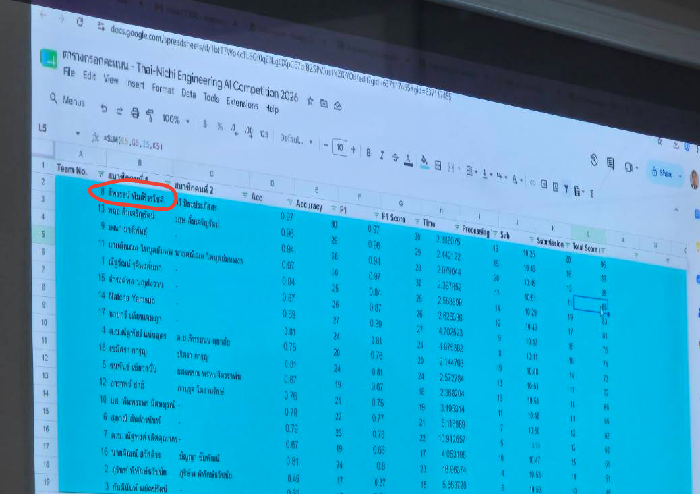

# Thai-Nichi Engineering AI Competition 2026

**รางวัลชนะเลิศอันดับ 1 ระดับชาติ (ทีม 2 คน)**

โปรเจกต์นี้เป็นโค้ดที่ผมและเพื่อนร่วมทีมใช้ในการแข่งขัน Thai-Nichi Engineering AI Competition 2026 เมื่อวันที่ 7 สิงหาคม 2026 โดยโจทย์คือการพัฒนา AI สำหรับจำแนกระดับความสุกของเนื้อสัตว์จากภาพถ่ายด้วยเทคนิค CNN (Convolutional Neural Network)

## การเตรียมตัวก่อนแข่งขัน

ก่อนการแข่งขัน ผมได้เข้าร่วมอบรมเกี่ยวกับ Neural Networks และ CNN เป็นเวลา 2 วัน หลังจากนั้นผมกับเพื่อนมีเวลาเตรียมตัวอีก 4 วัน จึงนำโค้ดตัวอย่างที่อาจารย์ให้มาลองศึกษาและทดลองปรับแต่งผ่าน Google Colab

ช่วงแรกผมยังไม่ค่อยเข้าใจว่าแต่ละส่วนของโค้ดทำงานอย่างไร จึงพยายามศึกษาหาข้อมูลเพิ่มเติม และร่วมกับเพื่อนทดลองปรับโครงสร้างโมเดลและค่าต่าง ๆ เพื่อดูว่าจะทำให้ AI จำแนกภาพได้ดีขึ้นอย่างไร

## โค้ดที่ใช้ในการแข่งขัน

อาจารย์ได้เตรียมโค้ดต้นแบบมาให้ โดยกำหนดให้ผู้เข้าแข่งขันเติมและปรับแต่งส่วนสำคัญ 4 ส่วน ได้แก่

1. Dataset Path — ตำแหน่งของชุดข้อมูล
2. Batch Size — ขนาดกลุ่มข้อมูลที่ใช้ฝึก
3. Model Architecture — โครงสร้างของโมเดล CNN
4. Epochs — จำนวนรอบในการฝึก

สำหรับไฟล์ที่ทีมใช้แข่งขัน มีการตั้งค่าดังนี้

| รายการ | ค่าที่ใช้ |
|---|---|
| ภาษา | Python |
| เครื่องมือ | Google Colab |
| Library | TensorFlow / Keras |
| ขนาดภาพ | 112 × 112 |
| Batch Size | 32 |
| Epochs | 100 |
| Training / Validation | 80% / 20% |

ภายในโค้ดมีการใช้ Conv2D และ MaxPooling2D ในการประมวลผลภาพ รวมถึง RandomRotation และ RandomZoom เพื่อเพิ่มความหลากหลายของข้อมูลระหว่างฝึก

นอกจากนี้ยังมีส่วนที่ใช้ตรวจสอบภาพที่โมเดลทำนายผิด โดยแสดงภาพพร้อมผลการทำนายและคำตอบจริง ทำให้สามารถดูได้ว่า AI ยังจำแนกภาพประเภทไหนผิดอยู่บ้าง

## ผลการแข่งขัน

จากตารางประกาศผลของผู้จัดการแข่งขัน ทีมของผมได้รับผลดังนี้

| เกณฑ์ | ผลลัพธ์ |
|---|---|
| Accuracy | 97% |
| F1 Score | 0.97 |
| Processing | 16/20 คะแนน |
| Submission | 20/20 คะแนน |
| **คะแนนรวม** | **96/100 คะแนน** |
| **อันดับ** | **1** |

การแข่งขันครั้งนี้ทำให้ผมได้เข้าใจมากขึ้นว่า AI ถูกสร้างและฝึกให้เรียนรู้จากข้อมูลได้อย่างไร พอได้ลองปรับโค้ดและทดลองฝึกโมเดลจริง ๆ ก็ทำให้ผมรู้สึกสนใจ AI มากขึ้น และอยากศึกษาต่อเกี่ยวกับเรื่องนี้

## หมายเหตุ

โค้ดเริ่มต้นมาจากอาจารย์ผู้สอน โดยผมและเพื่อนร่วมทีมได้ร่วมกันศึกษาและปรับแต่งเพื่อใช้ในการแข่งขัน

ปัจจุบันยังมีไฟล์ Python ที่ใช้แข่งขันอยู่ แต่ไฟล์โมเดล `.keras` ที่ส่งในวันแข่งขันไม่ได้เก็บไว้แล้ว ส่วนค่า Accuracy และ F1 Score ข้างต้นอ้างอิงจากผลการแข่งขันที่ผู้จัดประกาศ

### โค้ดที่ใช้ในการแข่งขัน

[ดูโค้ด Python ที่ใช้พัฒนาโมเดล CNN](zencode.py)

### หลักฐานผลการแข่งขัน

